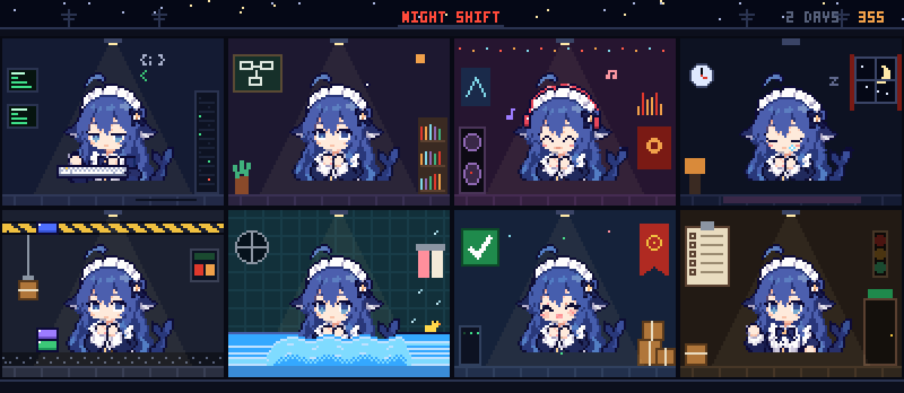
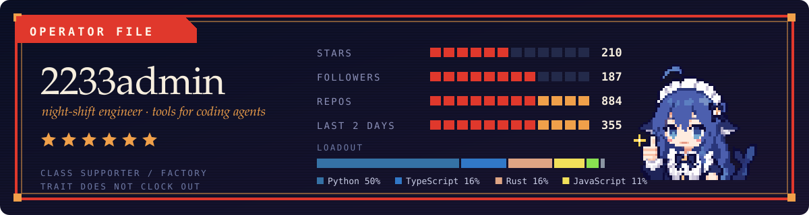

 

Live board. Rooms light up with the last two days of contributions; on a quiet day everyone sleeps. Redrawn every six hours. 鲸娘 · the whale maid is from <a href="https://github.com/ccch1mneyyy/dsh-Go">DSH Go</a>.

 

### 🏭 Now building

Tools for coding agents, and the factory around them: the queue, the gates, the merge, the measurement. Also on the line and not public yet: an overnight software factory and a merge queue built for agents.

 

### 🛰️ Selected work

 

### 🔧 Arsenal

 

### 🌙 Night shift log

<picture>
  <source media="(prefers-color-scheme: dark)" srcset="https://raw.githubusercontent.com/2233admin/2233admin/output/snake-dark.svg">
  
</picture>

 

### ✍️ House rules

Structure should carry the rules; a prompt shouldn't have to. 
Measure by ablation, not by impression. 
If it only works inside the demo, it isn't finished.

 

<picture>
  <source media="(prefers-color-scheme: dark)" srcset="assets/rule-dark.svg">
  
</picture>

НОЧНАЯ СМЕНА · night shift 

