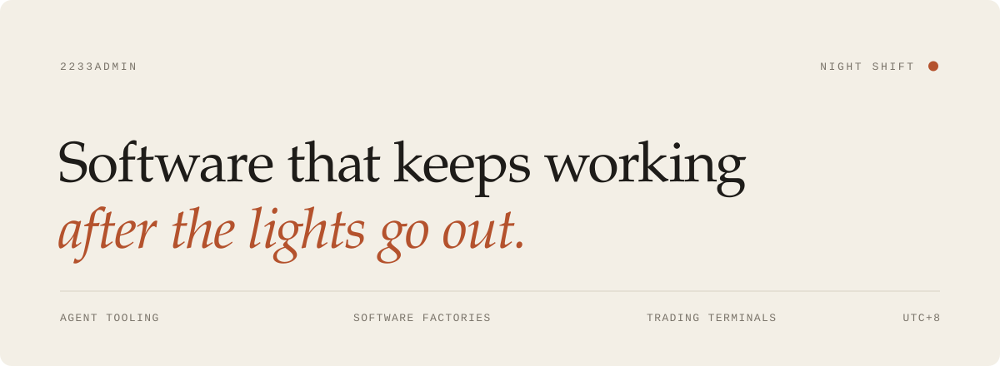

<picture>
  <source media="(prefers-color-scheme: dark)" srcset="assets/header-dark.svg">
  
</picture>

 

I build tools for coding agents, and the factory around them: the queue, the gates, the merge, the measurement. Most of it is small and command-line shaped. All of it is meant to be left running.

 

#### Selected work

**[obsidian-llm-wiki](https://github.com/2233admin/obsidian-llm-wiki)** 
A markdown vault compiled into a knowledge base agents can read, search and cite.

**[opencli-Razormind](https://github.com/2233admin/opencli-Razormind)** 
A self-hosted research pipeline. Collect, process, link the evidence; the data stays on your machine.

**[qmtcli](https://github.com/2233admin/qmtcli)** 
QMT wrapped as a local JSON CLI for A-share trading. Every order passes a guardrail.

**[cli2skill](https://github.com/2233admin/cli2skill)** 
Turns any CLI or MCP server into an agent skill, without the idle processes.

**[glyph-arts](https://github.com/2233admin/glyph-arts)** 
Charts drawn directly in the terminal. No browser, no files.

**[motion.md](https://github.com/2233admin/motion.md)** 
A plain-text format for describing motion and animation intent to a coding agent.

 

#### How I work

Structure should carry the rules; a prompt shouldn't have to. 
Measure by ablation, not by impression. 
If it only works inside the demo, it isn't finished.

 

<picture>
  <source media="(prefers-color-scheme: dark)" srcset="assets/rule-dark.svg">
  
</picture>

No badges, no counters. The work is in the repositories.
