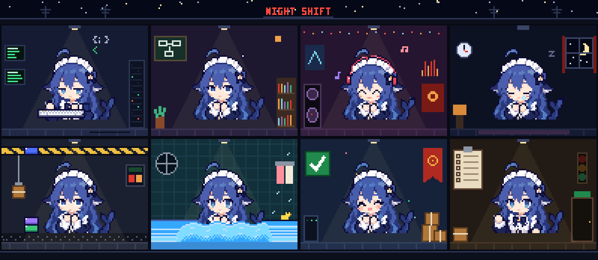
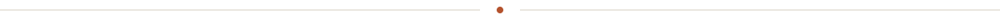

 

 

 

### 🛰️ Selected work

 

### 🔧 Arsenal

 

### 🌙 Night shift log

<picture>
  <source media="(prefers-color-scheme: dark)" srcset="https://raw.githubusercontent.com/2233admin/2233admin/output/snake-dark.svg">
  
</picture>

 

### ✍️ How I work

Structure should carry the rules; a prompt shouldn't have to. 
Measure by ablation, not by impression. 
If it only works inside the demo, it isn't finished.

 

<picture>
  <source media="(prefers-color-scheme: dark)" srcset="assets/rule-dark.svg">
  
</picture>

НОЧНАЯ СМЕНА · night shift

