 

I build tools for coding agents, and the factory around them: the queue, the gates, the merge, the measurement. Most of it is small and command-line shaped. All of it is meant to be left running.

 

### 🎨 Selected work

 

### 🧰 Paintbox

 

### 🌙 Night shift log

<picture>
  <source media="(prefers-color-scheme: dark)" srcset="https://raw.githubusercontent.com/2233admin/2233admin/output/snake-dark.svg">
  
</picture>

 

### ✍️ How I work

Structure should carry the rules; a prompt shouldn't have to. 
Measure by ablation, not by impression. 
If it only works inside the demo, it isn't finished.

 

<picture>
  <source media="(prefers-color-scheme: dark)" srcset="assets/rule-dark.svg">
  
</picture>

Header painted by hand in SVG — <a href="assets/paint.py">the brushwork</a> is in the repo.

